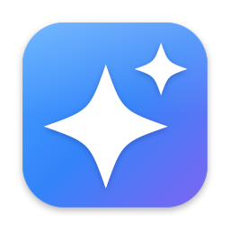
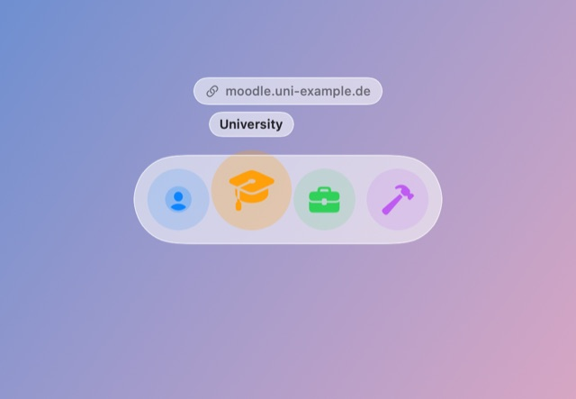
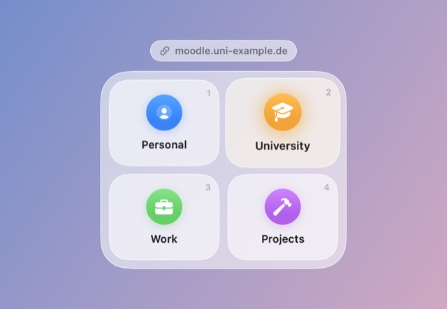
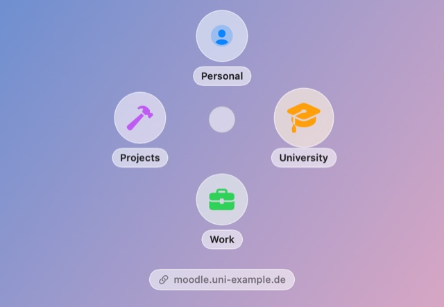

<p align="center">
  
</p>

<h1 align="center">Orbit</h1>

<p align="center">
  <b>Safari profiles without the friction, plus an AI agent that works in your real tabs.</b><br>
  A macOS menu bar app and Safari extension. Everything runs on your Mac.
</p>

<p align="center">
  
  
  
</p>
<p align="center"><sub>Three of the five profile picker designs. These snapshots are rendered offscreen; on screen the picker uses macOS Liquid Glass.</sub></p>

---

## What Orbit does

| | |
|---|---|
| 🪐 **Profile picker** | Press **⌃⌥P** (or use the menu bar) to jump to a Safari profile. Its window comes to the display you're on. Choose from five designs. |
| 🔗 **Links from other apps** | Make Orbit your default browser, and links from Mail, Messages or Slack open in the right profile, or ask you with the picker. |
| 🧭 **Website routing** | Rules such as `moodle.uni-example.de → University` open a site in the right profile. The tab you came from stays as it was. |
| 🔑 **Shared logins** *(opt-in)* | Stay signed in to chosen sites, such as ChatGPT or Google, in several profiles. Nothing is shared unless you turn it on per site. |
| 🕘 **Shared history** | **⌃⌥H** searches the pages you opened in *any* profile. Orbit keeps this history itself, on your Mac. |
| ✨ **AI agent sidebar** | Press **⌥⌘K** in Safari to open a sidebar where **Claude** or **ChatGPT** reads and operates your real tabs. With your permission, it can also work with files. |
| 🛡️ **Permissions you control** | Browser and computer access are set separately and enforced by Orbit, not by the AI. Sensitive actions ask first. |

The agent uses subscriptions you already have, with no API keys:
- **Claude:** your own [Claude Code](https://claude.com/claude-code) CLI, signed in with your Claude account.
- **ChatGPT:** OpenAI's official "Sign in with ChatGPT".

## Requirements

- **macOS 26 or later with Safari 26 or later** is recommended.
  - Orbit builds for macOS 14 and later.
  - Profile features rely on Safari's interface and were tested with **macOS 27.3 and Safari 27.3**.
- **Xcode 26 or later**, free from the Mac App Store. Orbit is built from source on your Mac; there's no prebuilt download.
- **Node.js 22 or later**, from [nodejs.org](https://nodejs.org) or `brew install node`.
- **Optional:** a free Apple ID in Xcode. Without one, Safari forgets the extension every time it restarts (see step 2).
- **Optional, for the AI agent:** a Claude subscription with Claude Code installed, or a ChatGPT plan.

## Install

**1. Build and install.** Open Terminal and run:

```bash
git clone https://github.com/johstn8/orbit.git
```

```bash
cd orbit && scripts/build.sh && scripts/install.sh
```

This puts `Orbit.app` in `~/Applications` and starts it. Orbit lives in the menu bar (two stars).

**2. Signing (recommended).** Do this before building, so Safari keeps Orbit enabled across restarts. It's free:
1. In **Xcode › Settings › Accounts**, add your Apple ID.
2. Select your team and choose **Manage Certificates… › + › Apple Development**.
3. Run the build again.

`build.sh` finds the certificate automatically.

Without a certificate, Orbit is signed "to run locally". Safari then only loads it while **Settings › Developer › Allow unsigned extensions** is on, and you must turn that on again after every Safari restart.

**3. Turn on the extension in Safari.**
1. Go to **Safari › Settings › Extensions**.
2. Turn on **Orbit**.
3. Allow it on all websites.
4. If you use profiles, also go to **Safari › Settings › Profiles › *each profile* › Extensions** and turn on **Orbit**.

**4. Allow permissions.** In **Orbit Settings › General**, allow:
- **Accessibility:** needed to read your profiles and switch windows.
- **Control Safari** (Automation): needed to open links in a profile that's asleep.
- **Full Disk Access** *(optional)*: shows Safari's profile colors.
- **Use Orbit as default browser** *(optional)*: lets Orbit handle links from other apps.

If something is missing later, Orbit's message tells you what and has a button that opens the right settings page.

## Set up the AI agent (optional)

- **Claude:**
  1. Install Claude Code:

     ```bash
     curl -fsSL https://claude.ai/install.sh | bash
     ```

  2. Sign in with your Claude account:

     ```bash
     claude auth login
     ```

     Alternatively, use **Sign In…** in **Orbit Settings › AI Agent**, which runs this command in Terminal for you.
- **ChatGPT:** in **Orbit Settings › AI Agent**, click **Continue with ChatGPT** and sign in in your browser.

Then open the sidebar in Safari with **⌥⌘K** or Orbit's toolbar button, and choose the model in the sidebar.

## Using Orbit

| Shortcut | What it does |
|---|---|
| **⌃⌥P** | Profile picker. Within the picker, use **1–9** or the arrow keys and **Return** to choose, and **Esc** to close. |
| **⌃⌥H** | Search history from all profiles. **Return** opens a page here; **⌘Return** opens it in the profile where you saw it. |
| **⌥⌘K** | Open or close the AI sidebar in Safari. |
| **⌥-click** a link | Open it in the current profile, skipping routing rules. |

You can change the picker shortcut, picker designs, routing rules, shared logins and agent permissions in **Orbit Settings** (menu bar › Settings…).

## Privacy and security

- **Local only.**
  - Orbit has no servers, no accounts and no analytics.
  - The app and the extension talk over `127.0.0.1` with a random per-launch token. Websites and other machines can't connect.
- **Your data stays on your Mac.**
  - Settings, chats and Orbit's history are stored in `~/Library/Application Support/SafariAgent` and are readable only by you.
  - ChatGPT tokens are kept in the macOS Keychain.
- **Logins are never exposed to the AI.**
  - Shared-login cookies only pass through memory, and are never stored, logged or given to a model.
  - Password fields are off-limits to the agent.
- **The AI only gets what you allow.**
  - Browser access can be this tab, this window, or all windows and profiles.
  - Computer access can be none, selected folders, or broader.
  - By default, file changes and actions such as submitting a form ask for your approval first. Deleting files and running commands always ask.
  - Credential stores such as `~/.ssh` and the Keychain are never accessible.
- **Web pages are treated as untrusted.** A page can't make the agent change files or send your local data to a website without your approval.

The AI providers receive what you send in a chat, plus the page content and files the agent reads for it, under their own terms.

## Troubleshooting

- **Orbit isn't listed in Safari's extensions:**
  - Make sure Orbit is running; its icon is in the menu bar.
  - Without a signing certificate, turn on **Safari › Settings › Developer › Allow unsigned extensions**. You may first need **Settings › Advanced › Show features for web developers**.
- **"Allow Accessibility for Orbit" although it's on:**
  - After a rebuild, macOS may no longer recognize the app.
  - In **System Settings › Privacy & Security › Accessibility**, remove Orbit with **−**, then turn it on again.
- **A tab shows "Reload to use Orbit here":** the tab was open while Orbit was updated. Reload it.
- **Claude isn't detected:** Orbit looks for `claude` in `~/.local/bin`, `~/.claude/local`, `/opt/homebrew/bin` and `/usr/local/bin`. Run `claude auth status` to check your sign-in.

## Update and uninstall

To update, from the `orbit` folder:

```bash
git pull && scripts/build.sh && scripts/install.sh
```

To uninstall:
1. Quit Orbit from the menu bar.
2. Delete `~/Applications/Orbit.app`.
3. To remove its data, delete `~/Library/Application Support/SafariAgent`.
4. In Keychain Access, delete the item `dev.local.SafariAgent.chatgpt`.
5. If Orbit was your default browser, choose Safari again in **System Settings › Desktop & Dock › Default web browser**.

## Limitations

- **The sidebar is part of the page:** Safari has no side-panel API, so the sidebar is attached to each page.
- **Safari's own history stays separate per profile:** Apple gives extensions no access to it, so Orbit keeps its own shared history instead.
- **Shared logins are a copy of the site's cookies:**
  - Signing out isn't mirrored.
  - Sites that tie sessions to a device or use passkeys may still ask you to sign in.
- **Profile names and icons come from Safari's interface,** through Accessibility. A future Safari update could change that interface.

## For developers

- [docs/ARCHITECTURE.md](docs/ARCHITECTURE.md): the system overview, components, message flows, security model, and the design decisions with the evidence behind them.
- [docs/REPORT.md](docs/REPORT.md): test results, fixed root causes and remaining limitations.

To run the unit tests, use these two commands. Neither sends prompts to Claude or ChatGPT.

TypeScript:

```bash
cd extension && npm test
```

Swift:

```bash
scripts/test-native.sh
```

```
extension/   Safari Web Extension (TypeScript, MV3): background, content script, React sidebar
native/      Orbit.app (Swift, SwiftUI): hub, profile picker, routing, shared logins, AI providers
scripts/     build.sh, install.sh, test-native.sh, make-icons.swift
tests/       routing fixture, integration driver, end-to-end tests (these send real prompts)
test-site/   local pages for testing
docs/        architecture, report, images
```

## License

Orbit is released under the [MIT License](LICENSE).

---

<sub>Orbit is an independent project and isn't affiliated with Apple, Anthropic or OpenAI. Safari is a trademark of Apple Inc.</sub>
