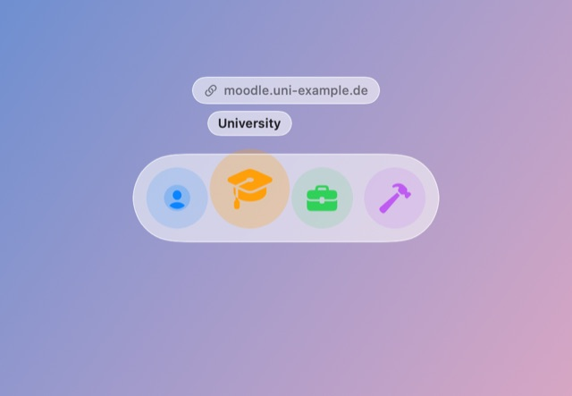
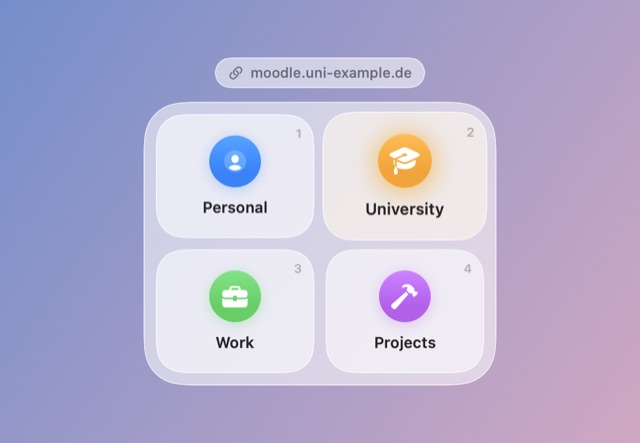
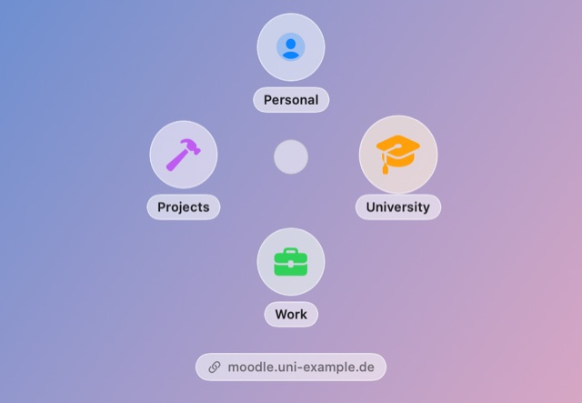
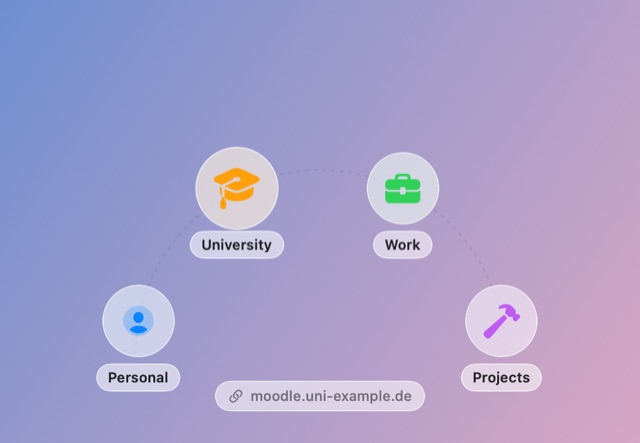
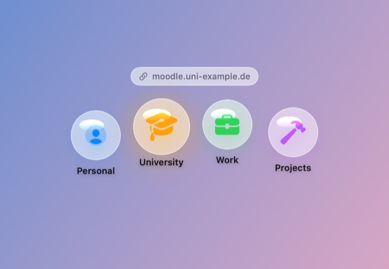

# Architecture and decisions

This is the technical overview of Orbit: how the parts fit together, how each feature works, the security model, and *why* things are built the way they are. The evidence was gathered during development on macOS 27.3, Safari 27.3 and Xcode 27. For installing and using Orbit, see the [README](../README.md); test results are in [REPORT.md](REPORT.md).

> **Names:** the project began as "Safari Agent" (v0.1.0, the AI sidebar only) and was renamed Orbit in 1.0.0. The bundle identifiers (`dev.local.SafariAgent…`) and the data folder (`~/Library/Application Support/SafariAgent`) keep the old name on purpose, so Safari keeps the extension enabled and existing chats, settings and Keychain items carry over.

## System overview

```
┌──────────────────────────────── Safari ─────────────────────────────────────┐
│ Profile "Personal"                    Profile "University"   (…one instance │
│ ┌──────────────────────────────┐      ┌──────────────────────┐  per profile)│
│ │ content.js (each page)        │      │ content.js            │             │
│ │  sidebar host + <iframe panel>│      │  …                    │             │
│ │  link routing (click capture) │      │                       │             │
│ │  DOM tools, make-room logic   │      │                       │             │
│ │ background.js                 │      │ background.js         │             │
│ │  tool executor + permissions  │      │  (same code, own      │             │
│ │  routing engine (stop+route)  │      │   storage, own tabs,  │             │
│ │  session sync (cookies API)   │      │   own cookies)        │             │
│ └──────────────┬───────────────┘      └──────────┬───────────┘             │
│   SafariAgentExtension.appex (sandboxed): hands out port + token             │
└────────────────┼─────────────────────────────────┼──────────────────────────┘
                 │ WebSocket ws://127.0.0.1:<port>, token auth, one per profile
┌────────────────▼─────────────────────────────────▼─── Orbit.app (menu bar) ─┐
│ Hub: instances by profile · conversations · runs · tool routing · approvals  │
│ ├─ ProfileRegistry + SafariController (focus/open in a profile, AX fallback) │
│ ├─ PickerController (5 Liquid Glass designs) + global hot key + URL handler   │
│ ├─ Router (rules for links from other apps, loop guard)                       │
│ ├─ SessionSharing (copies a site's cookies source → target profiles)          │
│ ├─ NativeTools (fs_* / run_command, path policy, approvals)                   │
│ ├─ ClaudeProvider ─ `claude -p` + MCP bridge ────────────────────────────────┼─► Claude Code
│ └─ ChatGPTProvider ─ Sign in with ChatGPT + Responses API ───────────────────┼─► api.openai.com
│ Settings window (SwiftUI): General · Profiles · Picker · Routing · Logins · AI│
└───────────────────────────────────────────────────────────────────────────────┘
```

Key ideas:

1. **One extension instance per Safari profile.** Safari runs a separate copy of the extension in each profile, with its own tabs, windows, cookies and storage.
   - Each instance connects to Orbit with its profile id.
   - The hub keeps one connection per profile. They never displace each other: in 0.1.0 they did, which was a root cause of slow loading.
   - To act in a profile, Orbit asks that profile's instance. For example, it opens a URL in the most recently used window, focuses a window or reads cookies.
2. **The native app owns everything shared:** settings, profile names, rules, logins, conversations, providers, file access and the picker.
3. **Permissions are enforced outside the model.** The extension enforces browser access and approvals. The native app enforces computer access, the path policy and file and command approvals.

---

## Features in detail

### Profile picker

- **When it opens:**
  - **Links from other apps:** Orbit can be the default browser (Settings › General › "Use Orbit…"; macOS confirms the change).
    - Each link goes through the routing rules first. If no rule matches, the picker appears at the pointer.
    - Hold **⌥** while clicking to always get the picker.
    - Other options: always ask, or use the last profile.
  - **Shortcut and menu bar:** the global shortcut is ⌃⌥P by default and can be changed in Settings. It uses Carbon hot keys, which need no permission. You can also use the menu bar ▸ Profile Picker.
    - Choosing a profile focuses its most recently used window, found through Safari's UI. This works even while that profile's extension sleeps.
    - The window comes to **the display and desktop where you used the picker**: a window on another display is moved there. If the profile only has windows on other Spaces, a new window opens here instead, because macOS doesn't let apps move windows between Spaces.
    - If the profile has no window, a new one opens.
    - The menu bar also lists the profiles directly.
  - **Safari's Dock icon with no window open:** Orbit notices the click and either opens a profile window (default: Safari's default profile) or shows your profiles in a row above the Dock. Set this in Settings › General › Safari Dock Icon.
- **Designs** (Settings › Picker Appearance, with live previews and a "Try It" button):
  - **Liquid Dock:** a glass capsule with Dock-like magnification.
  - **Glass Control Center:** a 2×2 grid of glass tiles.
  - **Glass Orbit:** circles around the pointer with a swirl-in animation.
  - **Arc Launcher:** a fan in a semicircle above the pointer, or below it near the top edge.
  - **Floating Pearls:** free-floating glass spheres with a gentle bob.

      

- **Common to all designs:**
  - SwiftUI `glassEffect` (Liquid Glass) on macOS 26+, with a material fallback on older systems.
  - Spring animations and hover feedback.
  - Optional names, and per-profile SF Symbol and color.
  - Keys: 1–9, arrows + Return, Esc. Clicking outside or switching apps dismisses it.
- **Window:** a borderless, non-activating `NSPanel`, like Spotlight. Safari stays the active app, and the panel covers the screen under the pointer so designs can be placed around it.
- **Profiles (Settings › Profiles):**
  - **Names, icons and order always come from Safari.**
    - File ▸ New Window ▸ New "…" Window lists every profile and marks the default one.
    - Each window's profile button carries the profile name and its SF Symbol (`TabGroupPickerButton?Profile=Work&Icon=briefcase.fill`).
  - **Colors** come from Safari's profile database when Orbit has Full Disk Access.
  - **Customize** per profile sets your own name, icon and color; turning it off returns to Safari's.
  - Profiles deleted in Safari disappear.
  - **Matching extensions:** each profile's extension is matched to a Safari profile automatically the first time one of its windows gets focus. "Match Extensions…" does it at once by opening one window per profile briefly.

### Website routing

- **Rules** (Settings › Website Routing):
  - Pattern syntax: `moodle.uni.de` (that host and its subdomains), `*.uni.de`, `github.com/myorg` (path prefix), `moodle.*.de`, or `/regex/`.
  - The first matching rule wins. "Stay in current profile" makes a rule an exception.
  - A test field shows where a URL would go.
- **Where rules apply**, and what happens to the current tab:

| Navigation | Mechanism | Effect on the current tab |
|---|---|---|
| Link click (also ⌘-click / middle-click / `target=_blank`) | Content script captures the click before the page sees it | Untouched (never navigates) |
| Typed URL, bookmark, script redirect in a tab showing a page | `webNavigation.onBeforeNavigate` → `window.stop()` in the old page (~20 ms) | Untouched. Measured: JS state and URL preserved, even with a 0 ms local server |
| Same, but the new page committed first (rare) | `tabs.goBack` | Safari restores the page (back-forward cache keeps JS state when the page is eligible) |
| New, empty tab (⌘T + typing, external link that landed in the wrong profile) | Route, then close the tab | Closed **only after** the target profile confirmed it opened the page |
| Link from another app (Orbit is the default browser) | Rules in the native app, else the picker | — |

- **The tab you came from:** a small glass notice says "Opened in University" and offers **Open Here Instead**.
- **If routing fails** (the profile isn't reachable):
  - Typed URLs open **in a new tab** in the current profile, so the kept page is never replaced.
  - Link clicks open normally.
- **Loop protection:** a URL just routed *to* a profile is never routed away from it again within 15 s. Tabs opened by routing are exempt from routing.
- **Overrides:**
  - ⌥-click a link to open it in the current profile.
  - "Open Here Instead" on the notice.
  - Pause routing for 15 min, 1 h or until tomorrow from the menu bar or Settings.
  - Turn routing off.
- **The agent and routing:** navigations by the agent (in its tab, or tabs it opens) are never routed, so its work stays where it is.
- **Not used:** `declarativeNetRequest` can block a navigation, but Safari then replaces the page with "blocked by a content blocker". That loses the page, as measured.

### Shared logins (opt-in)

- **Setup** (Settings › Shared Logins):
  - Add a website. Suggested: ChatGPT (`chatgpt.com` + `openai.com`) and Google (`google.com` + `youtube.com` + `google.de`). Also Claude, GitHub, Notion, or any domain.
  - **Several accounts:** Google keeps every signed-in account in one login. A second account added in the source profile ("Add another account") is shared too, and the first account stays the default.
    - For different accounts in different profiles, add the site twice, each with its own source and targets.
    - Orbit warns when two entries write to the same profile.
  - Choose the profile you sign in with (the **source**) and the targets: all other profiles or specific ones.
  - Add cookie names that should never be copied (exceptions).
  - Turn sharing on or off per site; nothing is shared by default.
- **How it works:**
  - **Which cookie store:** in non-default profiles Safari lists two cookie stores to the extension (measured):
    - The default store (calls without `storeId`) is not the one the profile's websites use.
    - The right store is the one Safari lists together with the profile's open tabs, and Orbit always writes there.
    - The default profile has a single store.
    - Earlier builds wrote into the wrong store, so logins didn't arrive. Those stray copies are removed automatically.
  - The source instance watches `cookies.onChanged` for those domains only and reports the domain (no values).
  - Orbit asks the source to export the site's cookies; HttpOnly cookies are included, as verified. It then asks each connected target instance to import them, replacing that site's old cookies.
  - It syncs when the login changes, when a profile connects, when you start using a target profile's window (at most every 10 minutes), and on "Sync Now".
  - Safari names a profile's store only while that profile is in use, and suspends idle extensions. Orbit therefore keeps the source's last login **in memory** (never on disk) for 12 hours, so a target can be updated while the source sleeps.
  - **Success is verified:** after importing, the target's store is read back. A target counts as shared when all cookies arrived, or only minor ones that Safari refused (no session or auth cookies).
  - "Sync Now" shows progress, then "Synced ✓" or "Not Synced" next to the status line.
- **Privacy:**
  - Cookie values only pass through memory over the authenticated loopback connection.
  - Orbit never writes or logs them.
  - They are never available to the AI tools or the model.
  - Other websites are never touched.
- **Limits:**
  - Device-bound or passkey sessions may not transfer.
  - Sign-out isn't mirrored; turn sharing off and sign out in each profile.
  - A target only updates while its profile is running.
  - iCloud Keychain passwords and passkeys already work in all profiles, which is the most robust alternative.

### Shared history (Settings › Shared History)

- **Pages from all profiles:** each profile's Orbit extension reports the pages you open (URL and title).
  - Private windows are never recorded, and you can exclude profiles.
  - Orbit stores them locally (`history.json`, 0600), for 3 months by default. "Clear Orbit History…" removes them.
  - The AI agent can't read them.
- **Search:** ⌃⌥H or the menu bar opens a glass search window over all profiles.
  - **Return** opens the page in the profile you're using now; **⌘Return** opens it in the profile you saw it in.
- **Orbit chats:** one chat history for all profiles, on by default (Settings › AI Agent).
  - Chats from other profiles are labeled with their profile.
  - The agent always works in the profile where you continue a chat.

### AI agent and permissions

**Browser access** is chosen per chat in the panel (shield menu or Settings) and enforced by the extension executor:

| Option | The agent may use |
|---|---|
| This tab only (default) | The tab where you sent the message, plus tabs it opens |
| All tabs in this window | Any tab in that window |
| All windows and profiles | Any tab in any connected profile |

- With the last option, `tabs_list` groups tabs by profile, and tools take `profile="<name>"`. The hub routes the call to that profile's instance.
- Approvals for actions in another profile are shown in **your chat's** panel (relayed by the hub).

**Computer access** is set in Orbit Settings › AI Agent or in the panel, and enforced by `NativeTools` in the app:

| Option | Tools offered to the model | Scope |
|---|---|---|
| No access (default) | none | — |
| Selected files and folders | `fs_list`, `fs_read`, `fs_search`, `fs_write`, `fs_edit`, `fs_move`, `fs_trash` | Only folders you picked in a macOS open panel. Paths are resolved through symlinks and `..`, and sibling folders are excluded |
| Broader access | the same, plus `run_command` (optional) | Read anywhere; change only inside your home folder |

Safeguards, independent of the model:

- **Never available:** credential stores and app data such as `~/.ssh`, Keychains, `~/Library/Safari`, `Containers`, browser profiles, `~/.claude`, Mail/Messages and Orbit's own data.
- **Reads** in allowed folders don't ask, unless you chose "Ask before every action".
- **Writes** ask, unless you chose "Approve for me". They **always ask in a chat that has read website content**, so a prompt injection can't silently change files.
- **Trash and shell commands** always ask. The approval shows the exact command.
- **Exfiltration guard:** after a chat has read local data, typing, form input, submits, navigation and new tabs ask first, in every mode.
- **Commands:** they run with `zsh -lc` and a minimal environment (no tokens). The default timeout is 60 s (max 300 s), output is capped, and Stop kills the process group.
- **Model side:**
  - For Claude, the file tools are served by Orbit's MCP bridge. Claude Code's own tools stay disabled (`--tools ""`).
  - When the access tier changes, the Claude session restarts with `--resume` so the tool list matches.
  - For ChatGPT, the tools are sent per request.
- **Folder choice:** folders can only be added through the macOS folder chooser, so neither a web page nor the extension can grant itself access.

### Sidebar fixes (root causes, details in REPORT)

| Symptom | Root cause | Fix |
|---|---|---|
| Very slow initial load | (1) Several profiles' instances kicked each other off the helper, with reconnect backoff up to 15 s. (2) The panel's first state could arrive before React subscribed and was dropped until the 20 s ping. (3) Provider status re-ran `claude` CLI checks on a cold start. | One connection per profile. The last state is cached for the late subscriber. Stale-while-revalidate provider status, plus cached providers in the extension. |
| Sidebar disappears briefly | Screenshots hid the panel. Any failed `hello` (background restarting) removed the panel. The host lived in `<body>`, which some apps re-render. | Screenshots crop the sidebar instead of hiding it. Only an explicit "closed" hides the panel. The host is attached to `<html>` and re-attached if removed. A re-show never rebuilds the panel. |
| Typing lands in the page | Synthesized input calls `focus()` on page elements. | If the composer had focus, it gets it back right after each tool. The draft and focus are also handed to the panel of the next page after navigations. |
| Laggy resizing | Every pointer move rewrote the page margin with a CSS transition, a full-page reflow per event. A full DOM scan (`getComputedStyle` for up to 6000 elements) ran every 2 s and on mutations. | The card follows the pointer via `requestAnimationFrame`. The page margin updates about 10×/s with no transition. Adjusted layers use one CSS variable (`--orbit-reserve`), so a resize rewrites one rule. Scans are incremental and time-sliced (≤6 ms per slice). |
| Website/tab badge in the composer | — | Removed. The optional **Selected text** chip stays. |
| Odd rectangular shadow at the corners | The host had `contain: strict`: paint containment cut the card's shadow at the host's rectangle | A separate shadow layer, no paint containment; the card clips its iframe with `clip-path` |
| Broken half-sidebar with "Reload" in old tabs (page not pushed, two boxes) | Tabs open during an update can't load the new panel frame | Orbit waits for the panel to confirm it booted (postMessage nonce **and** the background seeing its port). If not within 5 s, it removes the sidebar and shows **one** small "Reload to use Orbit here" card |

Other improvements:
- The content script runs at `document_start`, so the panel appears earlier after navigations.
- Messages are memoized, so streaming doesn't re-render the whole chat.
- Syntax auto-detection is limited while code streams.

---

## Components

### Safari extension (`extension/`, TypeScript, MV3)

The manifest grants `tabs`, `scripting`, `storage`, `nativeMessaging`, `activeTab`, `webNavigation`, `cookies` and `alarms`, plus `<all_urls>`. The content script runs at `document_start`.

| File | Role |
|---|---|
| `src/background/background.ts` | Instance hub. Details below the table |
| `src/background/helper.ts` | Connects to Orbit. Details below the table |
| `src/background/executor.ts` | Browser tools with per-call context. Details below the table |
| `src/background/routing.ts` | Routing engine: stop, route, fall back, close redundant tabs, exemptions |
| `src/background/sessions.ts` | Cookie export/import and change reporting for shared logins |
| `src/background/policy.ts` | Approval rules (unchanged), http(s)-only navigation |
| `src/background/tabrpc.ts` | Background → page calls via `scripting.executeScript` |
| `src/content/content.ts` | Sidebar host, make-room logic, link routing, routing notice, focus restore, tool handler |
| `src/content/dom-tools.ts` | Accessibility tree, find, page text, synthesized input, password and payment refusal |
| `src/panel/panel.tsx` | React sidebar. Details below the table |
| `src/shared/routing.ts` | Pattern matcher, identical to `Routing.swift` (shared test fixture) |
| `src/shared/tools.ts`, `protocol.ts` | Tool catalog (with `profile` param) and message types |

**`background.ts`** is the instance hub:
- Panel state, per-tab sidebar state, and per-tab draft and focus hand-over.
- RPC handler for Orbit (`open_url`, `focus_profile`, `approval`, `cookies_export`/`cookies_import`, …).
- Window focus and creation events (for the most recently used window).
- A keep-alive alarm.

**`helper.ts`** connects to Orbit:
- It gets the port, token and profile from the appex.
- Each profile keeps its own instance id (`orbitInstanceId`) in that profile's storage.

**`executor.ts`** runs the browser tools with a per-call context: owner profile, scope, approval mode and the exfiltration guard.
- Scope: this tab / window / all.
- Approvals for another profile's chat are relayed.
- Screenshots crop the sidebar out and are downscaled.

**`panel.tsx`** is the React sidebar:
- Shield menu with browser access (3 levels) and computer access (3 levels, choose folders).
- Model picker, history and settings.
- Draft persistence and memoized messages.

### Native app (`native/`, Swift, Xcode project `SafariAgent.xcodeproj`)

| File | Role |
|---|---|
| `App/AppDelegate.swift` | Menu bar, link handling, default browser, hot key, transient notices. Details below the table |
| `App/SettingsView.swift` | SwiftUI settings: General, Profiles, Picker Appearance, Website Routing, Shared Logins, AI Agent, About |
| `Picker/PickerController.swift` | Picker panel, keyboard, Carbon hot key, color helpers |
| `Picker/PickerDesigns.swift` | The five designs, Liquid Glass helpers, live previews, and `--render-designs <dir>` (development snapshots) |
| `Core/Hub.swift` | Per-profile instances, request routing, runs, tool routing, approvals, tool catalog, debug driver |
| `Core/AppSettings.swift` | Settings model and store (`settings.json`, 0600). Missing fields get defaults; an unreadable file is kept as a copy |
| `Core/Profiles.swift` | `ProfileRegistry`, `SafariAX` and `SafariController`. Details below the table |
| `Core/Routing.swift` | `RoutePattern` (matcher) and `Router` (route.open, loop guard, links from other apps) |
| `Core/SafariDockWatcher.swift` | Safari's Dock icon with no window open: opens a profile window or shows the profiles in a row |
| `Core/HistoryStore.swift`, `Picker/HistoryPanel.swift` | Shared history across profiles and its search window |
| `Core/SessionSharing.swift` | Shared-login orchestration (source → targets) |
| `Core/NativeTools.swift` | File and command tools, `PathPolicy`, `FolderPicker` |
| `Core/Prompts.swift` | System prompt (browser, profiles, files, safety) and per-message context (profile, access levels) |
| `Core/WebSocketServer.swift`, `MCPBridge.swift`, `ConversationStore.swift`, `Support.swift` | Loopback server, Claude's MCP bridge, conversations (with `profileId`), helpers |
| `Providers/*` | Claude Code runner, Sign in with ChatGPT, ChatGPT Responses loop |
| `SafariAgentExtension/SafariWebExtensionHandler.swift` | Hands the extension the port, token and Safari profile id (when Safari provides it) |

**`AppDelegate.swift`**:
- The menu bar menu: picker, profiles, pause routing, settings.
- Link handling (`application(_:open:)`) and the default-browser switch.
- The hot key and transient glass notices.

**`Profiles.swift`**:
- `ProfileRegistry`: syncs names, icons, order and default from Safari; matches extensions to profiles on window focus; handles Customize and deleted profiles.
- `SafariAX`: reads Safari's New Window menu and each window's profile button; raises and moves windows; tells which windows are on the current Space.
- `SafariProfileStore`: reads profile colors from `SafariTabs.db` with Full Disk Access, read-only.
- `SafariController`: focuses a profile's window (on the picker's display and Space) and opens URLs in a profile, through the extension when awake, else Safari's UI + AppleScript.

### Message flow examples

- **Link from Mail:**
  1. macOS calls Orbit's `application(_:open:)`.
  2. The `Router` checks the rules, or the picker returns a profile.
  3. `SafariController.open` → hub `callInstance(profile, "open_url")` → that profile's background creates a tab in its most recently used window and focuses it. Orbit then activates Safari.
- **Moodle typed in the Personal profile:**
  1. The Personal background gets `onBeforeNavigate` and runs `window.stop()` in the tab, so the page is kept.
  2. It sends `route.open {url, profileId: University}` to the hub.
  3. The hub calls the University instance's `open_url`, which reports success.
  4. The Personal tab shows "Opened in University".
- **Agent edits a file:**
  1. The model calls `fs_edit`.
  2. Hub → `NativeTools`: the tier and path policy are checked.
  3. An approval is needed → hub `callInstance(owner, "approval")` → the panel shows the change preview.
  4. On Allow, the file is edited atomically.

### Where data lives

| What | Where |
|---|---|
| Settings (profiles, picker, rules, shared sites, computer access) | `~/Library/Application Support/SafariAgent/settings.json` (0600) |
| Shared history (pages from all profiles) | `…/SafariAgent/history.json` (0600) |
| Conversations (now with `profileId`, history per profile) | `…/SafariAgent/conversations/*.json` (0600) |
| Helper connection | `…/SafariAgent/connection.json` (port + per-launch token, 0600) |
| ChatGPT tokens | Login Keychain (`dev.local.SafariAgent.chatgpt`) |
| Claude login | Managed by Claude Code itself |
| Per-profile extension state (instance id, panel tabs, drafts, cached config) | Safari extension storage of that profile |
| Shared-login cookies | Only in Safari's cookie stores; Orbit keeps them in memory while copying |

---

## Security model (summary)

- **Local only:**
  - Orbit listens only on loopback; web origins are refused.
  - It uses a per-launch 256-bit token, and a per-conversation token for the MCP bridge.
  - Each extension instance is identified by profile.
- **Least privilege for models:**
  - Claude Code runs without built-in tools; ChatGPT gets only Orbit's tools.
  - File and command tools exist only when you enable computer access.
- **Untrusted content:**
  - Page text is wrapped as untrusted, and Markdown is sanitized with images dropped.
  - Web content can't trigger file writes or commands without approval.
  - Local data can't be sent to websites without approval.
- **Approvals happen in the extension and the app, independent of the model.** If no panel is open to ask, the action is denied.
- **Logins are never exposed:**
  - The agent never sees Safari's cookies or passwords, and password fields are refused.
  - Shared-login cookies never pass through any tool.


---


## Decisions with evidence

| Question | Finding | Decision |
|---|---|---|
| Can the Claude subscription power an agent without an API key? | `claude -p --input-format/--output-format stream-json` streams answers, calls MCP tools, resumes sessions and accepts `interrupt`; auth is `claude.ai` | Run the unmodified CLI with a clean environment, `--tools ""`, `--strict-mcp-config`, `--setting-sources ""` and Orbit's MCP bridge. The tool list follows the computer-access tier, and a tier change restarts the session with `--resume` |
| ChatGPT without an API key | Sign in with ChatGPT (dynamic client, PKCE, loopback redirect); `POST /v1/responses` with `store:false` | Native Swift OAuth, tokens in the Keychain, Responses agent loop |
| Native side panel in Safari 27? | `side_panel` is unsupported | Page-attached sidebar (shadow-DOM host + extension iframe) |
| Safari MCP / WebDriver for the agent? | WebDriver sessions run in isolated automation windows | All tools run in the extension, in the user's real tabs |
| **Which profile is an extension instance?** | `SFExtensionProfileKey` arrives with Safari's profile UUID for **non-default** profiles and is **absent for the default profile** (observed with 4 profiles) | Use Safari's UUID when present. The default profile's instance creates a random id once and keeps it in its own extension storage (separate per profile) |
| **Profile names, icons, order** | Extensions get no profile names. Safari's container is TCC-protected. Safari 27's UI exposes them through Accessibility identifiers: `New<Name>Window?isDefaultProfile=true\|false` in File ▸ New Window, and `TabGroupPickerButton?Profile=<Name>&Icon=<SF Symbol>` on each window's profile button | Read both (opt-in Accessibility). Instances are matched to names when one of their windows gets focus (the hub hears `windows.onFocusChanged`; AX names the focused window's profile), or at once with "Match Extensions…". Placeholders `safari:<name>` stand in for profiles whose extension hasn't been matched yet; rules and logins move over when matched |
| **Profile colors** | Not exposed through Accessibility. Stored in Safari's `SafariTabs.db` (needs Full Disk Access) | Optional read-only reader with a tolerant plist scan for colors and symbols. Without access, Orbit's colors are used |
| **Open/focus in a profile** | Instances sleep ~30 s after use (connection log: connect … disconnect 30 s later, again at the next 1-minute alarm), so they are often unreachable. AX can raise windows and press menu items at any time | Focus through Safari's UI: the front-most window whose profile button matches, moved onto the picker's display and Space; else press "New … Window". Open URLs through the instance when it is awake, else raise the profile's window and `make new tab` via AppleScript |
| **Keeping instances reachable** | Non-persistent background pages sleep; event listeners and alarms wake them | Listeners for windows/tabs/webNavigation/cookies, a 1-minute `alarms` keep-alive. Routing waits for the persisted config when a navigation woke the background, so it doesn't miss it |
| **History / bookmarks / sessions** | `browser.history`, `bookmarks`, `topSites` and `sessions` are all undefined in Safari 27 (capability probe); Apple keeps history per profile by design | Orbit records visits itself through each instance (`tabs.onUpdated`, not in private windows) into a local shared history with its own search window. It never writes Safari's databases |
| **Cookie stores per profile** | A non-default profile's extension listed two stores: `persistent-3` with the profile's tabs, holding the cookie a page just set, and `persistent-4` with no tabs, which is the default for calls without `storeId`. The default profile lists one store. A store with tabs is only listed while the profile is in use | Choose the store listed with this profile's tabs (or the single store in the default profile), otherwise report "no open tab" and retry when the profile is used. Read back after importing. Remove copies that earlier builds put into the unused store |
| **Profile colors** | `SafariTabs.db` → `settings` table, key `ProfileColor` per profile row (parent = `bookmarks.id`): a keyed archive with `redComponent`/`greenComponent`/`blueComponent`/`alphaComponent`/`colorName` (`clear` = no color). Symbols are in `bookmarks.extra_attributes` → `SymbolImageName`; the default profile's row has `external_uuid = DefaultProfile` | Read-only with Full Disk Access; decode the components; `clear` → gray |
| **Extension reconnects after updates** | After an update the default profile's instance stopped connecting for minutes. A native message pending while the Orbit app was replaced never settled, and every later `ensure()` waited on that attempt | 8 s timeout on `sendNativeMessage`, and an attempt older than 12 s is abandoned |
| **Stopping a navigation without losing the page** | Measured with the local test site: <br>• `declarativeNetRequest` block → `onBeforeNavigate` + `onErrorOccurred` fire, but Safari shows **"Safari Can't Open the Page … blocked by a content blocker"**; the original page is gone, and Back didn't restore it. <br>• A plain navigation then `tabs.goBack` → the page was restored **with JS state** (bfcache). <br>• `window.stop()` injected on `onBeforeNavigate` → the stop lands ~20–30 ms after the start; the URL is unchanged and the JS state (counter) is kept, with server delays of 0, 150 and 600 ms | Use `window.stop()`. If the new page commits anyway, go back. No `declarativeNetRequest`. Link clicks are intercepted in the content script, which is lossless by construction |
| **Shared logins** | `browser.cookies.getAll` returns the profile's cookies **including HttpOnly**. `cookies.set` writes them (verified: a HttpOnly `session` value changed through import); each instance sees only its own profile's single cookie store | Copy the cookies of opted-in domains from the source profile to target profiles through the instances, never persisted or logged by Orbit |
| **App identity** | Safari keys the extension by bundle id; the Keychain ACL and data folder use the old names | Display name and product **Orbit**; bundle ids `dev.local.SafariAgent(.Extension)` and the `SafariAgent` data folder are unchanged |

## Process and trust boundaries

```
web page (untrusted) ──DOM──► content.js (isolated world)
                                 │ runtime messages / executeScript RPC
                         background.js (one per Safari profile)
                                 │ WebSocket 127.0.0.1, token, role "extension", profile id
                         Orbit.app hub  ◄── MCP bridge (role "mcp", per-conversation token) ◄── claude -p
                                 │                                          ChatGPT Responses ◄─┘
                         NativeTools (path policy, approvals)  ──►  your files (only if allowed)
```

- **Origins and authentication:**
  - The hub refuses web origins and compares tokens in constant time.
  - Driver-only methods (`debug.agent_settings`) check the role.
  - Folders can only be added through the native folder chooser.
- **Where permissions are enforced:**
  - **Browser scope and page-action approvals:** the extension's executor. Each call carries its owner profile, scope, approval mode and the exfiltration guard. Calls are isolated with `Object.create(this)`, so concurrent chats never share permissions.
  - **Cross-profile calls:** the hub permits them only for runs with scope `all`. Approvals are relayed to the owner's panel.
  - **Computer access:** `NativeTools` and `PathPolicy` in the app.
- **Taint tracking:** this is per conversation and kept by the hub.
  - Any browser tool result marks the chat "read web content", so writes ask.
  - Any local read or command marks it "read local data", so the extension asks before typing, submitting or navigating.

## Sidebar lifecycle (after the 1.0 fixes)

1. **Host:**
   - `content.js` runs at `document_start` and says `hello`. The background answers with the panel state for this tab.
   - The host is appended to `<html>` (not `<body>`), with `contain: layout style`. Paint containment would cut the card's shadow at the host's rectangle. A host guard re-attaches the host if a site removes it.
   - Re-showing never rebuilds the iframe.
2. **Make room:**
   - `:root{--orbit-reserve}` plus `html{margin-right: var(--orbit-reserve)}`.
   - Fixed layers ≥ 40 % of the width are pinned (`right: var(--orbit-reserve)`). Smaller ones are shifted (`translate: calc(-1 * var(--orbit-reserve))`). In-flow `100vw` elements get `max-width: calc(100vw - var(--orbit-reserve))`.
   - The scanner is incremental: added subtrees are walked; class/style changes check only that element. It runs in ≤ 6 ms slices, reads before it writes, and does a cheap 2 s integrity check of the adjusted layers.
3. **Panel boot:**
   - The host shows the card at once, but the iframe only becomes visible when the panel confirms it booted: a postMessage with a secret nonce from the frame URL, or the background seeing the panel's port for this tab.
   - Without that confirmation within 5 s (a tab left over from an update, or a site blocking the frame), the sidebar is removed and one "Reload to use Orbit here" card appears.
   - Note: Safari returns `iframe.src` masked (`…url://hidden/`) to content scripts, so the URL must be built once and never read back.
   - The panel connects a runtime Port and caches the last state, so the first state can't be lost.
   - Drafts and focus are stored per tab in the background and handed to the next page's panel.
4. **Tools:** if the composer had focus before a page tool, `iframe.focus()` restores it right after.
5. **Screenshots:** `captureVisibleTab`, then the sidebar area is cropped using the page's `reserve` and viewport width, then the image is downscaled (`` decode + canvas in the background page).

## Tests and the test driver

```bash
cd extension && npm test     # 50 TypeScript tests: DOM tools, approvals, markdown, routing patterns (shared fixture)
```

```bash
scripts/test-native.sh       # 105 Swift tests: OAuth/JWT, SSE, WebSocket origin policy, routing fixture, path policy, tool catalog, settings decoding, Safari profile identifiers, shared-login conflicts, prompt context
```

The suites below **send real prompts** and use plan quota. Run them only on purpose:

```bash
node test-site/server.mjs &                                  # local test pages (supports ?delay=ms and /setcookie)
```

```bash
node tests/e2e/safari-e2e.test.mjs --provider claude          # real-Safari agent acceptance tests
```

**Prompt-free checks** use the helper's test driver. Connect as role `driver` with the token from `connection.json`; see `tests/integration/lib.mjs`.
- `debug.state`: connected instances and the connection log.
- `debug.tool`: runs a browser or file tool without AI.
- `debug.call`: an extension instance method, e.g. `caps`, `windows` or `cookies_export`.
- `debug.probe`: sidebar statistics, e.g. panel creations, hides, slice times, focus restores.
- `debug.agent_settings`, `debug.focus_profile`, `debug.safari_profiles`: driver only.
- `route.add_rule` / `route.remove_rule`: add or remove a routing rule.
- `debug.call raw_capture`: a screenshot including the sidebar.

**Picker snapshots:** `Orbit.app/Contents/MacOS/Orbit --render-designs <dir>` writes PNGs of all five designs. Glass is replaced by flat surfaces, because offscreen rendering can't draw it.

---

## Project layout

```
extension/                 Safari Web Extension (TypeScript, MV3, esbuild)
  src/background/          background.ts, helper.ts, executor.ts, routing.ts, sessions.ts, policy.ts, tabrpc.ts
  src/content/             content.ts (sidebar host, make-room, link routing), dom-tools.ts
  src/panel/               panel.tsx, panel.css, markdown.ts
  src/shared/              tools.ts, protocol.ts, routing.ts
  test/                    vitest unit tests
native/
  SafariAgent/App/         main.swift, AppDelegate.swift, SettingsView.swift
  SafariAgent/Picker/      PickerController.swift, PickerDesigns.swift
  SafariAgent/Core/        Hub, AppSettings, Profiles, Routing, SessionSharing, NativeTools, Prompts, WebSocketServer, MCPBridge, ConversationStore, Support
  SafariAgent/Providers/   ClaudeProvider, ChatGPTAuth, ChatGPTProvider
  SafariAgentExtension/    SafariWebExtensionHandler.swift
  Tests/main.swift         Swift unit tests
scripts/                   build.sh, install.sh, test-native.sh, make-icons.swift (draws the icons: white sparkles on blue for the app, blue sparkles without background for the extension)
tests/                     fixtures/routing-cases.json, integration/, e2e/
test-site/                 local test pages
docs/                      ARCHITECTURE.md, REPORT.md
```

## Reference archive

`Chrome-Extensions/` (Claude in Chrome 1.0.107, ChatGPT extension 1.26) was used read-only for concepts in 0.1.0. Nothing was copied, and the folder is excluded from the repository.
